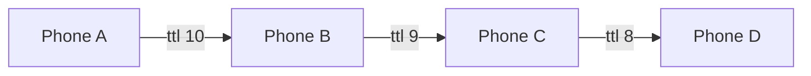

# District Mesh

[](https://github.com/Swastikkkkk/District_Mesh/actions/workflows/build.yml)

Offline peer-to-peer mesh for iPhone. Phones find each other over Bluetooth and peer-to-peer Wi-Fi, form a mesh, and relay chat, live location and SOS alerts across multiple hops. Voice and video calls run over the same encrypted links.

No internet, no cell signal, no server. Built for places where networks fall over: concerts, festivals, treks, disaster zones.

## What it does

| Feature | How it works |
|---|---|
| **Multi-hop chat** | Every packet carries a TTL of 10. Each phone re-sends it to its neighbours except the one it came from, so a message reaches people far outside the sender's range. A seen-packet cache drops loops and duplicates, so everyone gets it exactly once. |
| **Store and forward** | Send with nobody around and the message is queued, then delivered the moment a buddy connects. |
| **SOS** | One tap floods your live location to the whole group every 5 seconds, even with the screen locked. Buddies get an alert, a red pin and a compass pointing at you. Stopping SOS sends an all-clear. |
| **Buddy map and compass** | Bearing and distance to every buddy who is sharing location. |
| **Voice and video calls** | Raw PCM audio and JPEG video frames over `MCSession` byte streams, one per direction. No WebRTC, no signalling server. Calls work with buddies you're directly connected to. |
| **Private groups** | Phones only connect when their group codes match. Both the browser and the invited phone check the code. |
| **Auto reconnect** | If a buddy drops and comes back into range, the app re-scans and reconnects on its own. |
| **System integration** | Live Activity and Dynamic Island, a Mesh Status widget, a Control Center SOS button, and Siri / Shortcuts actions. |

### How the relay works



A and D are never in range of each other. The message still arrives, exactly once. This logic is tested on every push by a simulation that runs the app's real packet and router code over chains, loops and a 15-phone line (see `Tests/RelaySimulation`).

## Install

You need **at least two iPhones on iOS 26 or later**. The simulator has no Bluetooth or peer-to-peer Wi-Fi, so it can't form a mesh.

### Option A: build with Xcode (Mac)

1. Install **Xcode 26** or newer.
2. Clone and open:
   ```bash
   git clone https://github.com/Swastikkkkk/District_Mesh.git
   cd District_Mesh
   open DistrictMesh.xcodeproj
   ```
3. Select the **DistrictMesh** target, go to **Signing & Capabilities** and pick your team. Do the same for the **WidgetExtension** target.
4. If you're not on the original developer team, change the bundle IDs so they're unique to you:
   - `com.swastik.districtmesh` on DistrictMesh
   - `com.swastik.districtmesh.Widget` on WidgetExtension (must start with the app's ID)
   - the App Group `group.com.swastik.districtmesh` on both targets, plus the same string in `DistrictMesh/SharedStore.swift` and `Widget/Widget.swift`
5. Plug in an iPhone, pick it as the run destination, press **Run**. On the phone, trust the developer under **Settings > General > VPN & Device Management** the first time.
6. Repeat on the second phone.

> **Free Apple ID (Personal Team)?** It can't use App Groups. Remove the **App Groups** capability from both targets and the app works fully. Only the home screen widget stays empty, since it can't read the app's data.

### Option B: no Mac (Windows or Linux)

Every push builds an unsigned IPA on GitHub Actions.

1. Open the newest green run under [Actions](https://github.com/Swastikkkkk/District_Mesh/actions/workflows/build.yml) (sign in to GitHub), scroll to **Artifacts** and download `DistrictMesh-unsigned-ipa`. Unzip it to get `DistrictMesh-unsigned.ipa`.
2. Install [Sideloadly](https://sideloadly.io) or AltStore, connect your iPhone, drop in the IPA and sign in with your Apple ID.
3. On the phone, trust the developer under **Settings > General > VPN & Device Management**.

Free Apple IDs re-sign apps every 7 days, so you'll need to reinstall weekly.

## First run

1. Open the app, enter your name and a **group code** (anything, like `fest24`). Leave it blank to join the open mesh.
2. Allow **Local Network**, **Location** and **Microphone** when asked. Without Local Network, phones can't see each other.
3. Do the same on the second phone with the **same group code**.

## Prove it works

Turn off **Wi-Fi network** and **Mobile Data** on every phone (keep Bluetooth on, and leave the Wi-Fi radio enabled in Control Center but not joined to any network).

| Test | Expected |
|---|---|
| Open the app on two phones, same group | "<name> joined the mesh" within a few seconds |
| Send a chat message | Shows on the other phone |
| Send a message with no one connected, then bring a phone close | Message shows "queued", then delivers on connect |
| Three phones: A, B, C with A and C far apart (different floors), B in between | A's messages reach C through B |
| Tap the phone icon on a buddy | Both phones go into a call, audio both ways |
| Turn on video in the call | Both cameras stream |
| Tap the location icon (SOS) on one phone | Others get an SOS alert and a red pin; compass points to it |
| Stop SOS | The red pin clears on other phones |
| Walk out of range and back | Buddy reconnects without restarting the app |
| Different group codes | Phones never connect |

Settings > Diagnostics shows a live log of discovery, invites and connections if anything misbehaves.

## Shortcuts, Siri, widget, Control Center

- **Siri:** "Go live on District" or "Send SOS on District". Both also appear in the Shortcuts app and can be put on the Action button.
- **Control Center:** add the **Mesh SOS** control. One tap opens the app and starts SOS.
- **Widget:** add **Mesh Status** (small or medium) to see how many buddies are nearby and any active SOS.
- **Live Activity:** shows your nearest buddy and distance on the Lock Screen and Dynamic Island while the mesh is live.
- Deep links: `districtmesh://sos` and `districtmesh://open`.

## Limits to know

- **Keep the app open.** iOS suspends MultipeerConnectivity in the background, so the mesh only relays while the app is in the foreground. SOS location sharing keeps running with the screen locked, but it only reaches buddies while links are up.
- **Up to 8 direct links per phone** (an Apple limit per session). Multi-hop relaying is how the mesh grows past that.
- **Calls are direct only.** Voice and video need the buddy within direct range. Chat, location and SOS go multi-hop.
- **Names should be unique** within a group, since peers are identified by display name.
- Range is roughly 10 to 30 m per hop on Bluetooth, more on peer-to-peer Wi-Fi, depending on walls and crowds.

## Tech

| Layer | Tech |
|---|---|
| Discovery and transport | MultipeerConnectivity (Bluetooth + peer-to-peer Wi-Fi), encryption required |
| Packets and routing | Codable `MeshRelayPacket` (stable `id`, `ttl`, `kind`), `MeshRouter` for dedupe and forwarding |
| Calls | AVAudioEngine and AVCapture over `MCSession` streams |
| Location | CoreLocation, MapKit |
| System | ActivityKit, WidgetKit, ControlWidget, App Intents |
| UI | SwiftUI, Observation |

## Project structure

```
DistrictMesh/
  ViewModels/MeshConnectivityManager.swift   discovery, sessions, relay, outbox, SOS, reconnect
  Models/MeshRelayPacket.swift               packet, seen cache, router
  MeshVoiceCallManager.swift                 voice and video calls
  LiveActivityController.swift               Live Activity and Dynamic Island
  AppIntents.swift                           Siri and Shortcuts actions
  SharedStore.swift                          App Group data for the widget
  Views/                                     dashboard, chat, map, compass, call, onboarding
Widget/                                      Mesh Status widget, SOS control, Live Activity UI
Tests/RelaySimulation/                       multi-hop relay simulation (runs in CI)
.github/workflows/build.yml                  builds the app, runs the simulation, packages the IPA
```

Run the relay simulation yourself on a Mac:

```bash
xcrun swiftc DistrictMesh/Models/MeshRelayPacket.swift Tests/RelaySimulation/main.swift -o relay-sim && ./relay-sim
```

## Troubleshooting

- **Phones never find each other:** check Settings > Privacy & Security > Local Network > District is on, both phones use the exact same group code, and Bluetooth is on.
- **"Local Network access is off" banner:** same fix as above, then reopen the app.
- **No audio in a call:** allow Microphone in Settings > District.
- **Widget shows 0 or nothing:** you're on a free team without App Groups, or the app hasn't been opened since install.
- **Live Activity missing:** Settings > District > Live Activities must be on.
