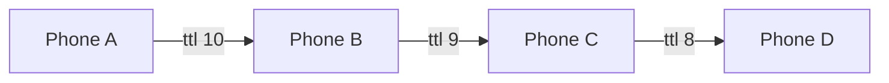

# District Mesh

Offline peer-to-peer mesh for iPhone. Phones find each other over Bluetooth and peer-to-peer Wi-Fi, form a mesh, and relay messages, live location and SOS alerts across multiple hops. Voice and video calls ride the same encrypted links.

No internet, no cell signal, no server. Built for the places where networks fall over: concerts, festivals, treks, disaster zones.

## Features

- **Multi-hop messaging.** Every packet carries a TTL (default 10). Each phone re-broadcasts it to its neighbours, minus the one it came from, so messages reach people well outside the sender's range. A seen-packet cache drops loops and duplicates.
- **Store and forward.** Messages sent with nobody nearby are queued and delivered the moment a peer connects.
- **Live location and buddy compass.** Locations flood the mesh. A map and compass point you to each buddy with bearing and distance.
- **Panic mode.** One tap broadcasts an emergency location to the whole group until you stop it.
- **Voice and video calls.** Raw PCM audio over `MCSession` byte streams, one stream per direction for full duplex. Video can be switched on mid-call. No WebRTC, no signalling server.
- **Private groups.** Peers only connect when their group codes match. A token tie-break decides who sends the invite, so two phones never invite each other at the same time.
- **System integration.** Live Activity and Dynamic Island for the nearest buddy, a Control Center toggle, widgets, and an App Intent for Siri and Shortcuts.

## How the relay works



A and D are never in range of each other. The message still arrives, exactly once.

| Layer | Tech |
|---|---|
| Discovery and transport | MultipeerConnectivity (Bluetooth + peer-to-peer Wi-Fi), encryption required |
| Packets | Codable `MeshRelayPacket` with a stable `id`, `ttl` and `kind` |
| Calls | AVFoundation audio and camera pipelines over `MCSession` streams |
| Location | CoreLocation, MapKit |
| System | ActivityKit, WidgetKit, App Intents |
| UI | SwiftUI, Observation |

## Project structure

```
DistrictMesh/
  ViewModels/MeshConnectivityManager.swift   discovery, sessions, relay, outbox, panic mode
  Models/MeshRelayPacket.swift               the packet that travels the mesh
  MeshVoiceCallManager.swift                 voice and video calls
  LiveActivityController.swift               Live Activity and Dynamic Island
  FindPlayersIntent.swift                    App Intent
  Views/                                     dashboard, map, compass, call, onboarding
Widget/                                      widgets, control, Live Activity UI
```

## Run it

You need a recent Xcode with the iOS 27 SDK and at least two physical iPhones. The simulator has no Bluetooth or peer-to-peer Wi-Fi.

1. Open `DistrictMesh.xcodeproj`.
2. Pick your team under Signing & Capabilities for each target.
3. Install on two or more phones, join with the same group code, then kill cellular and leave your Wi-Fi network to prove it.
